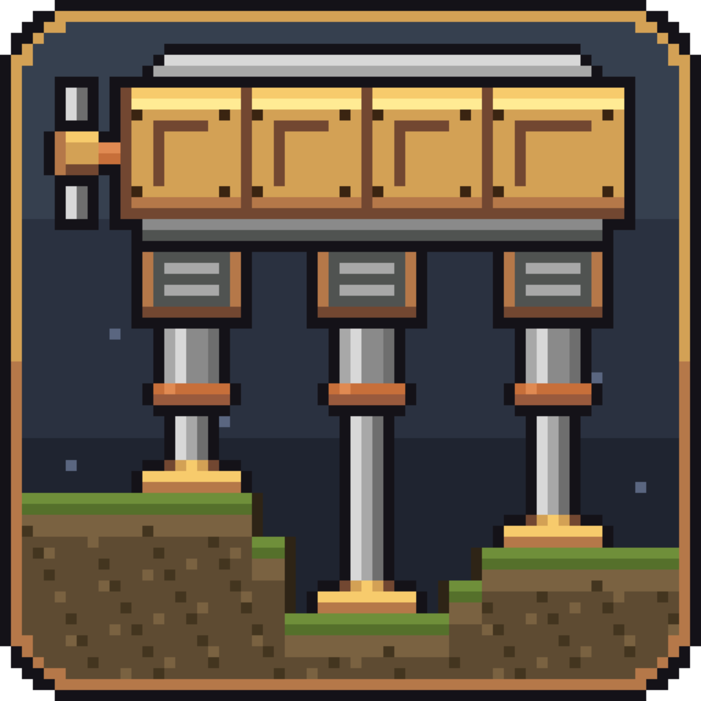
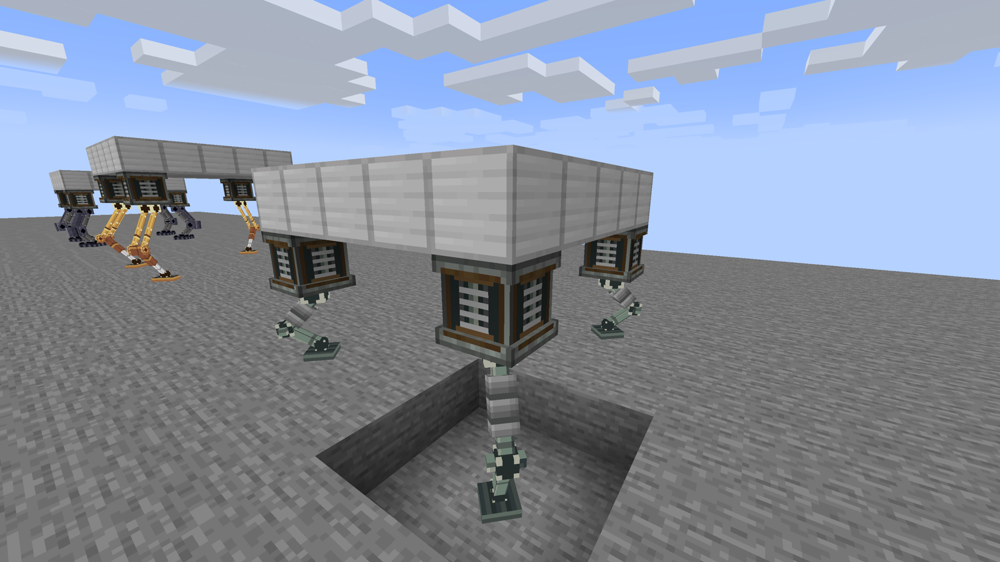
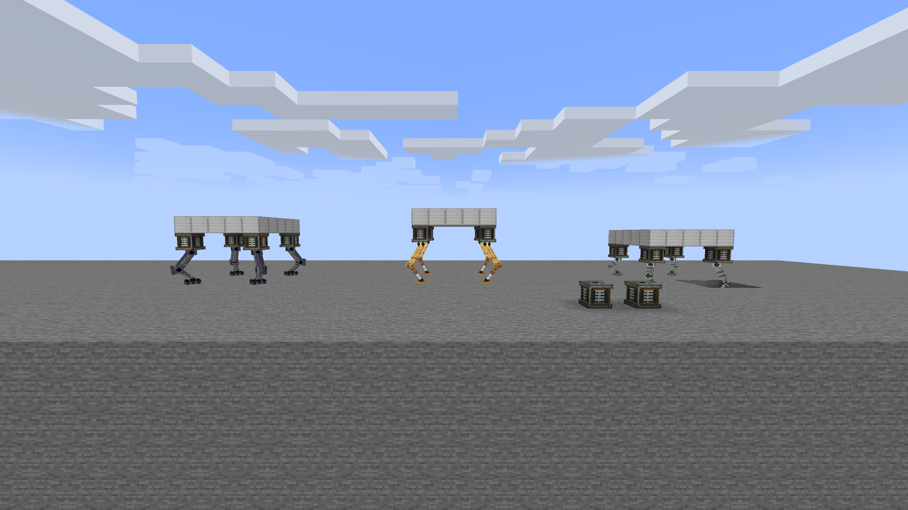
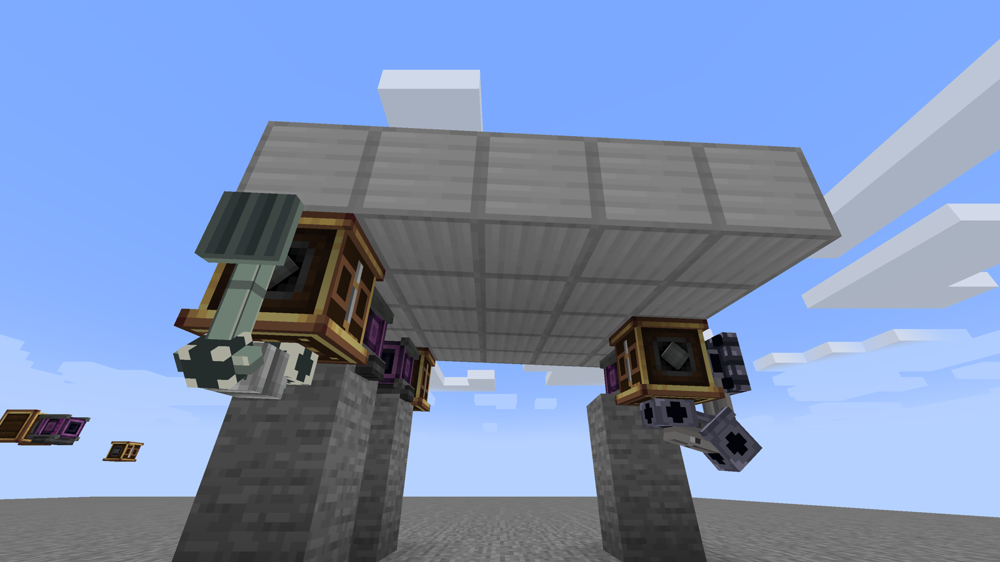
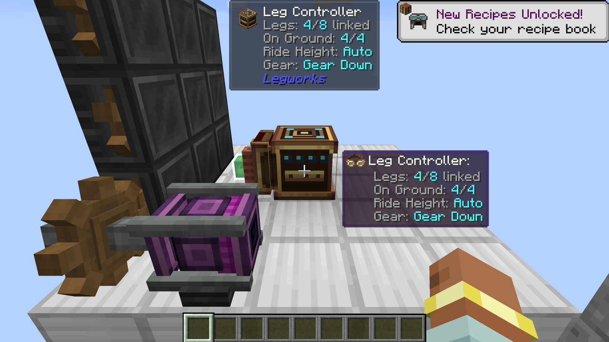
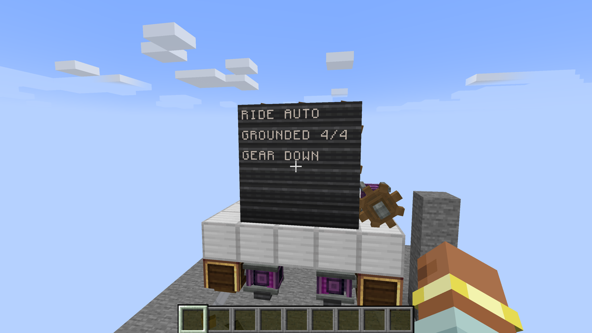
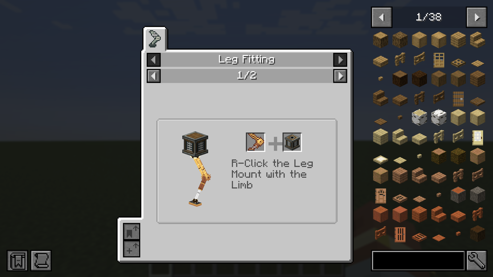

<p align="center">
  
</p>

# Create Aeronautics: Landing Legs

Adaptive landing legs for Create Aeronautics Ships. Land on uneven ground and stay level.

[](LICENSE)
[](https://www.minecraft.net/)
[](https://neoforged.net/)



## What it does

Put a **Leg Mount** on your Ship's hull and fit a **Limb** into it. That makes a **Leg**. Each Leg reaches down to the ground on its own, so the deck stays level on slopes, steps and holes. Simple Legs work by themselves. Hydraulic Legs are run by a **Leg Controller**, which sets the Ride Height and folds the Legs up for flight.

The terms used here (Ship, Leg, Limb, Reach, ...) are explained in the [glossary](docs/CONTEXT.md).

## Features

- **Leveling**: every Leg picks its own Reach, so the Ship sits level on uneven ground.
- **Foot grip**: Feet hold like rubber pads, so a parked Ship does not slide off a slope.
- **Crouch**: while one Foot is still looking for ground, the other Legs lower the Ship together so it does not tip.
- **Overreach**: if the ground is too uneven, the Legs stretch to the max and the Ship tilts toward the low side, like it would in real life.
- **Two Leg types**: Simple Legs (no power, no setup) and Hydraulic Legs (powered, adjustable).
- **Leg Controller**: sets Ride Height, links up to 8 Hydraulic Legs, and does **Gear Up / Gear Down** with redstone.
- **Softening**: a redstone signal on top of a Hydraulic Leg makes it softer, for example to kneel a parked Ship for loading.
- **Bumpers**: a Leg Mount facing sideways or up acts as a spring against ground it meets.
- **Stands on other Ships**: Legs can land on another Ship and push it back.
- **Entities collide with the drawn leg**: entities bump into it instead of passing through.
- **Three Limbs** with their own look, Reach and Stiffness.
- Create-style tooltips, Ponder scenes, Engineer's Goggles info, Jade, JEI and Display Link support.



## Blocks and items

| Block / item | What it is | Power | Tier |
|---|---|---|---|
| **Simple Leg Mount** | Levels the Ship on its own. Fixed Stiffness and Damping. Always Gear Down. | none | andesite |
| **Hydraulic Leg Mount** | Needs a Linked Leg Controller. Stiffness (25–200%) and Damping (0.2–1.5) set on its sides. Softens with power loss or top redstone. | 4 SU per RPM | brass |
| **Leg Controller** | Links up to 8 Hydraulic Legs within 16 blocks. Sets Ride Height. Redstone = Gear Up. | none | brass |

Any Limb fits any Leg Mount. The Limb decides the Leg's maximum Reach and base Stiffness.

| Limb | Max Reach | Base Stiffness | Default height | Tier |
|---|---|---|---|---|
| **Short Limb** | 3 blocks | x1 | 2.0 blocks | andesite (early) |
| **Long Limb** | 4.5 blocks | x1 | 3.0 blocks | brass (mid) |
| **Heavy Limb** | 3.5 blocks | x2 (sags half as much, for big Ships) | 2.3 blocks | sturdy (late) |

Recipes: Short Limb, Simple Leg Mount and Leg Controller are crafted in a crafting table. Long and Heavy Limbs use the Mechanical Crafter. The Hydraulic Leg Mount is made by Sequenced Assembly. Check JEI for the exact recipes.

## How to use

1. **Place a Leg Mount** on your Ship's hull, facing down. It faces the side you click; sneak while placing to flip it, or turn it with a Wrench.
2. **Fit a Limb**: right-click the Mount with a Limb. Sneak-click with an empty hand to take it back.
3. **Assemble the Ship** as usual. Off a Ship, Leg Mounts do nothing.
4. **Simple Legs are done now.** They level the Ship by themselves at the Limb's default height.
5. **For Hydraulic Legs, link a Leg Controller**:
   - Place the Leg Controller on the same Ship.
   - Sneak-click the placed Controller with a Leg Controller item to select it.
   - Click each Hydraulic Leg Mount to link it. Click again to unlink.
   - You can also click the Legs first and then place the Controller. Linking works before or after the Ship is assembled.
6. **Power** each Hydraulic Leg Mount through its shaft. Faster rotation = faster Reach changes (a full Gear Up takes about 4 s at 16 RPM). Without power, or when overstressed, the Legs Soften fully and the Ship settles onto the ground.
7. **Ride Height**: scroll the value box on top of the Leg Controller, in steps of 0.1 block. 0 = **Auto** (each Leg uses its Limb's default height). The maximum is the longest Reach among the Linked Limbs.
8. **Gear Up / Gear Down**: give the Leg Controller a redstone signal to fold the Legs against the Ship for flight. Remove the signal to unfold them for landing.



Ponder (hold `W` over an item) shows all of this step by step.

## Compatibility

- **Ponder** (comes with Create): scenes for fitting, facing, leveling, linking, Ride Height, power and Softening.
- **Engineer's Goggles**: each Leg shows Reach, load, Stiffness, power and warnings (Overreach, Not linked, Conflicting Ride Height).
- **Jade** (optional): the same status as the goggles.
- **JEI** (optional): recipes, a "Leg Fitting" category and info pages for every item.
- **Create Display Link**: the Leg Controller and Leg Mounts are Display Link sources (Ride Height, grounded Legs, Gear state, Reach, load).

| Goggles | Display Link | JEI |
|---|---|---|
|  |  |  |

## Requirements

| Mod | Version |
|---|---|
| Minecraft | 1.21.1 |
| NeoForge | 21.1.228 or newer |
| Create | 6.0.10 or newer, below 6.1.0 |
| Create Aeronautics | 1.3.2 or newer, below 1.4.0 |
| Sable | 2.0.5 or newer, below 2.1 |
| JEI, Jade | optional |

Built and tested with NeoForge 21.1.250, Create 6.0.10, Create Aeronautics 1.3.2 and Sable 2.0.5.

## Install

1. Install the required mods above.
2. Drop the `legworks-1.0.0.jar` file into your `mods/` folder.
3. Install it on **both** the client and the server.

## Config

Server config: `config/legworks-server.toml`. A copy in a world's `serverconfig/` folder overrides it for that world. Defaults are tuned; most players never need to change them.

| Section | Key | Default | What it does |
|---|---|---|---|
| `leg` | `restSag` | 0.5 | How far a x1 Limb compresses under its full share of the Ship's weight, in blocks |
| `leg` | `simpleDampingRatio` | 0.8 | Damping of Simple Legs (1 = no bounce) |
| `leg` | `gripFriction` | 1.2 | Foot grip friction |
| `leg` | `gripOmega` | 8.0 | Foot grip spring strength (rad/s) |
| `leveling` | `levelGain` | 0.4 | Slow leveling correction speed |
| `leveling` | `loadGain` | 1.0 | Evens out the load between diagonal Legs |
| `leveling` | `rideGain` | 0.3 | How fast the Ship moves to its Ride Height |
| `leveling` | `offloadGain` | 1.0 | Moves anti-roll work into leg lengths so flat ground ends level |
| `leveling` | `maxRestRate` | 0.5 | Max leg length change, blocks per second |
| `leveling` | `crouchRate` | 3.0 | Crouch speed, blocks per second |
| `leveling` | `antiRoll` | 6.0 | Anti-roll stiffness |
| `leveling` | `antiRollDamp` | 0.04 | Anti-roll damping time, seconds |
| `hydraulic` | `maxLegsPerController` | 8 | Most Legs one Leg Controller can link |
| `hydraulic` | `linkRange` | 16 | Longest Link, in blocks |
| `hydraulic` | `hydraulicStressImpact` | 4.0 | Stress impact of a Hydraulic Leg Mount, SU per RPM (needs a restart) |
| `hydraulic` | `strokeRpmSeconds` | 64.0 | Seconds a full-Reach stroke takes at 1 RPM (at 16 RPM: 64 / 16 = 4 s) |
| `hydraulic` | `softenRate` | 2.0 | How fast Softening follows power loss or top redstone |

Tooltips, JEI pages and Ponder text show the default numbers (8 Legs, 16 blocks, 4 SU per RPM). They do not change when you edit the config.

## Custom Limbs (data component)

There is no datapack registry for Limbs. Instead, **any item that carries the `legworks:limb` data component is a Limb** and fits any Leg Mount. So a datapack (recipe or loot table result with `components`), a command, or another mod can turn an item into a Limb:

```mcfunction
/give @s minecraft:iron_bars[legworks:limb={reach:5.0,nominal_rest:3.5,min_rest:1.2,stiffness:1.5}]
```

| Field | Range | Meaning |
|---|---|---|
| `reach` | 0.25–16 | Maximum Reach, blocks |
| `nominal_rest` | min_rest–reach | Default height (Simple Legs, and Ride Height Auto) |
| `min_rest` | 0.05–reach | Shortest length Leveling and Crouch may use |
| `stiffness` | 0.05–100 | Base Stiffness multiplier |

Custom Limbs are drawn with the Short Limb look. This path works in code but is less tested than the three built-in Limbs.

## Known limitations

- **High drops**: there is no special landing mode yet. Drops of more than about 20 blocks, especially into a pit or while the Ship is spinning, can tip the Ship over.
- **No Funnel insertion**: Limbs can't be inserted into Leg Mounts by Funnels or other automation. Fit them by hand.
- **Pinned to Sable 2.0.x**: the mod uses mixins into Sable internals (entity collision on the drawn leg, Display Link fix on assembly). A newer Sable may need a new Landing Legs version.
- Narrow, tall Ships are less stable. Use a wider track or stiffer Limbs.
- A Mount boxed in by blocks at its own level shows the folded leg inside those blocks after Gear Up (visual only).

## FAQ

**I set Ride Height higher than my Limb can reach. What happens?**
The scroll stops at the longest Reach among the Linked Limbs. With mixed Limbs, each Leg is also clamped between its own Limb's shortest length and its maximum Reach, so a short Limb just stretches to its max.

**Which Ships can use Legs?**
Any Ship assembled with Create Aeronautics / Sable. Leg Mounts placed in the world (not on a Ship) do nothing.

**Can I mix Simple and Hydraulic Legs?**
Yes. Simple Legs level on their own; the Leg Controller only drives its own Linked Legs. Several Controllers on one Ship also work: they all aim for level, and different Ride Heights settle in between.

**Why is the mod id `legworks`?**
That was the working name. The mod id stays `legworks` so existing worlds keep their blocks, items and settings. Don't rename it in forks if you want save compatibility.

## Building from source

Needs JDK 21 or newer (Gradle uses a Java 21 toolchain).

```sh
./gradlew build        # jar in build/libs/
./gradlew runClient    # dev client
./gradlew runServer    # dev server
```

## Contributing

Bug reports, ideas and pull requests are welcome. See [CONTRIBUTING.md](CONTRIBUTING.md) and the [Code of Conduct](CODE_OF_CONDUCT.md). Design notes are in [docs/](docs/): [glossary](docs/CONTEXT.md), [design](docs/design.html), [decisions](docs/adr/), [save format](docs/save-format.md).

## License and credits

Landing Legs is released under the [MIT License](LICENSE). Copyright (c) 2026 SenDeliver.

Built on top of, but **not bundling**:

- [Create](https://github.com/Creators-of-Create/Create) by the Create team (MIT)
- Create Aeronautics by its authors (see its own license)
- Sable by its authors (PolyForm Shield license)

Thanks to the Offroad addon for the Wheel Mount pattern that the Leg Mount + Limb design follows.

Developed with AI assistance (Claude); design, testing and direction by SenDeliver.
